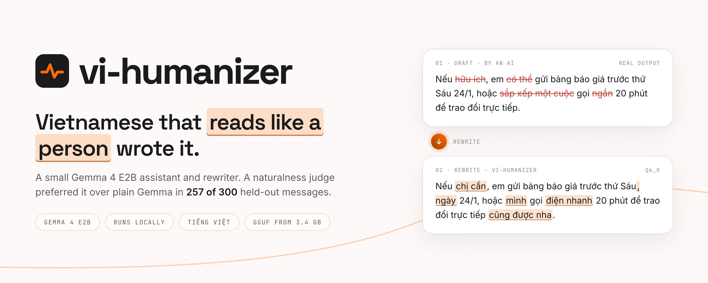

# vi-humanizer local app

A web app for the vi-humanizer model. **Viết lại** (Rewrite) takes a draft an AI wrote and rewrites it so it reads
like a Vietnamese person wrote it. It shows what was cut and what was added, and checks that every number, date,
time and percentage made it through. **Trò chuyện** (Chat) is a plain assistant that answers in natural Vietnamese.
Everything runs on your machine, offline once the model is downloaded.

## Start

macOS or Linux (installs llama.cpp with Homebrew if it is missing):

```bash
./install.sh                    # first run downloads the Q6_K model (3.8 GB); opens the first free port from 7860
./install.sh --quant Q4_K_M     # the smallest file (3.4 GB)
./install.sh --port 9000 --gguf ~/models/vi-humanizer-e2b-Q6_K.gguf
./install.sh -- -t 4            # anything after -- goes to llama-server, e.g. CPU threads on a busy machine
```

Windows (installs llama.cpp with winget if it is missing):

```powershell
.\install.ps1
.\install.ps1 -Quant Q4_K_M
```

There is no Python and no Node. `llama-server` downloads the model (`-hf`), serves the API, and serves `web/` as
static files, all on one port. The GGUF carries its own chat template (thinking off) and sampling defaults.

## Other runtimes

`web/` is a static site that talks to any OpenAI-compatible server. Serve it however you like
(`python3 -m http.server -d web 7860`) and point it at the server in Settings (⋯), or in the URL:

- **Ollama:** put `vi-humanizer-e2b-Q6_K.gguf` next to `Modelfile`, run `ollama create vi-humanizer -f Modelfile`, then
  open `?api=http://127.0.0.1:11434/v1&model=vi-humanizer`.
- **LM Studio:** load the GGUF, start its server with CORS on, then open `?api=http://127.0.0.1:1234/v1&model=<id>`.

The browser calls these servers directly, so they must allow cross-origin requests from the page's address.
